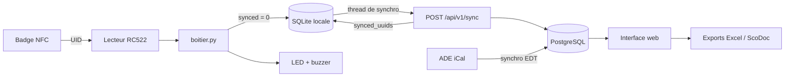
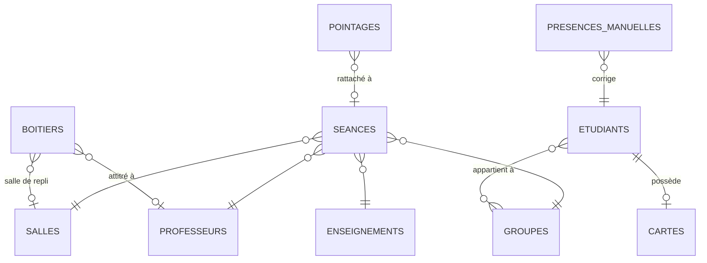

# Documentation technique — architecture

Système de pointage des étudiants par badge NFC (SAÉ 5.B.01). Ce document reprend le livrable d'architecture et le met à jour avec ce qui a réellement été construit.

## 1. Vue d'ensemble

Trois composants :

| Composant | Matériel / techno | Rôle |
|---|---|---|
| **Boîtier** | Raspberry Pi + lecteur RC522 + RTC DS3231 + LED + buzzer | lit le badge, horodate en UTC, stocke en local (SQLite), signale par LED/son, envoie au serveur |
| **Serveur** | FastAPI + PostgreSQL (Docker) | reçoit les lots de bips, les rattache aux cours, calcule présences / retards / absences |
| **Interface web** | Jinja2 + Bootstrap 5 | enrôlement des cartes, étudiants et groupes, emploi du temps, émargement, suivi des absences, exports Excel |

Chaque professeur a un boîtier attitré, identifié par un `device_id` unique et authentifié par un token.



## 2. Flux d'un pointage

1. **Lecture** : l'étudiant approche sa carte, le RC522 lit l'UID (4 ou 7 octets).
2. **Enregistrement local** : le boîtier génère un UUIDv4, prend l'heure UTC (RTC) et écrit la ligne dans SQLite avec `synced = 0`, **avant tout envoi réseau**. LED verte + bip.
3. **Synchronisation** : un thread d'arrière-plan envoie les lignes non synchronisées (toutes les 10 s et après chaque bip).
4. **Validation serveur** : le serveur enregistre, rattache au cours et renvoie la liste des UUID reçus. Le boîtier les passe à `synced = 1`.
5. **Exploitation** : l'interface interroge PostgreSQL pour l'émargement, les bilans et les exports.

## 3. Modèle de données (PostgreSQL)



| Table | Contenu principal |
|---|---|
| `etudiants` | numéro étudiant, nom, prénom, identifiant ScoDoc |
| `groupes` + `etudiant_groupe_association` | groupes (TD, TP, promo) ; un étudiant peut être dans plusieurs groupes |
| `cartes` | `nfc_uid` (clé) → étudiant (une carte par étudiant) |
| `boitiers` | `device_id`, token, professeur attitré, salle de repli, dernière synchro |
| `pointages` | `uuid` (clé, vient du boîtier), `nfc_uid`, `device_id`, heure (Paris), séance rattachée, heure de réception |
| `seances` | créneaux importés d'ADE (UID iCal, enseignement, groupe, salle, prof, début, fin) |
| `presences_manuelles` | correction d'un statut par le professeur (prioritaire sur les bips) |

Les tables manquantes sont créées au démarrage et les colonnes ajoutées automatiquement (`models.py`).

## 4. Communication boîtier ↔ serveur

`POST /api/v1/sync`, en-tête `Authorization: Bearer <token>` :

```json
{
  "device_id": "RPI-001",
  "batch": [
    {"uuid": "3f2b…", "nfc_uid": "10D65D56", "timestamp": "2026-10-07T06:02:11Z"}
  ]
}
```

Réponse : `{"status": "success", "synced_uuids": [...], "rejected_uuids": [...], "server_time_utc": "...", ...}`. Elle contient aussi la liste des cartes connues (`cartes_connues`), que le boîtier garde en local pour reconnaître une carte inconnue même hors ligne.

| Cas | Comportement |
|---|---|
| Token absent ou faux | 401, le boîtier garde ses bips et réessaie |
| Même lot renvoyé (coupure pendant l'accusé) | aucun doublon : l'`uuid` est la clé |
| Date illisible dans un bip | ce bip est rejeté, les autres passent |
| Carte inconnue | bip enregistré quand même, attribuable plus tard |
| Lot vide | sert de signal de vie (« boîtier en ligne ») |

`GET /api/v1/status` permet au boîtier de vérifier que le serveur répond.

## 5. Choix pour les problématiques du sujet

| Problématique | Solution |
|---|---|
| **Pas de réseau, coupure de courant** | SQLite locale (mode WAL), bip écrit avant l'envoi, renvoi automatique, UUID pour l'idempotence. Testé : 1 000 bips hors ligne puis synchro sans perte. |
| **Enregistrer simplement les étudiants** | Import Excel de la scolarité ; association d'une carte en un clic (lecteur USB sur le poste, ou boîtier d'accueil « Scanner la carte »). Aucune saisie d'UID à la main. |
| **Démarrage rapide, pas d'attente** | Raspberry Pi OS Lite, service systemd lancé au boot ; aucune requête réseau pendant le scan. |
| **Groupes qui changent** | Groupes en base (jamais codés en dur), relation plusieurs-à-plusieurs ; purge RGPD de fin d'année. |
| **Plusieurs boîtiers en même temps** | `device_id` + token par boîtier ; testé avec deux boîtiers en parallèle. |
| **Planning × pointages** | EDT importé d'ADE (iCal). Un bip est rattaché au cours du professeur du boîtier qui couvre l'heure (dès 15 min avant), sinon à la salle du boîtier. |
| **Présence réelle sur un long cours** | Premier bip = arrivée, dernier bip = sortie. Les créneaux qui se suivent forment un seul cours. |
| **Horloge sans réseau** | Module RTC DS3231 sur l'I2C ; le boîtier horodate en UTC, le serveur convertit en heure de Paris (été/hiver). |
| **Sauvegarde** | `pg_dump` / `pg_restore` (voir le README) ; exports Excel pour l'administration. |

### Règles de statut

* premier bip avant début + 15 min → **Présent** ; après → **En retard** ; aucun bip → **Absent** ;
* un cours sans aucun bip ni correction est considéré **sans appel** et n'entre pas dans les calculs ;
* une correction manuelle du professeur l'emporte toujours ;
* seuls les cours terminés comptent dans les bilans d'absences.

## 6. Choix technologiques

| Composant | Techno | Pourquoi |
|---|---|---|
| OS du Pi | Raspberry Pi OS Lite | pas d'interface graphique, démarrage rapide |
| Programme du boîtier | Python | accès simple au GPIO, SPI et I2C |
| Base locale | SQLite (WAL) | un seul fichier, résiste aux coupures |
| Lancement | systemd | démarre au boot, relance en cas de plantage |
| API | FastAPI | rapide, validation des données (Pydantic), doc Swagger auto (`/docs`) |
| Base centrale | PostgreSQL 15 (Docker) | relationnel robuste, installation en une commande |
| Interface | Jinja2 + Bootstrap 5 | pages rendues côté serveur, pas de framework JS à maintenir |
| Exports | Pandas + Openpyxl | fichiers Excel attendus par la scolarité / ScoDoc |

## 7. Écarts par rapport au livrable 1

* **Groupes** : relation plusieurs-à-plusieurs au lieu d'une simple clé `groupe_id` (un étudiant est à la fois dans un TD, un TP et une promo).
* **Double badge entrée/sortie** : pas obligatoire ; le premier bip donne l'arrivée et le dernier la sortie.
* **LED** : la bleue indique l'état de la connexion au serveur ; le détail des signaux est dans `boitier/README.md`.
* **Ajouts** : corrections manuelles par le professeur, comptes professeurs, feuille d'absences ScoDoc, page de filtrage des pointages, cartes connues envoyées au boîtier.
